

# sxwrpv — motion kit

**Front-end design & motion portfolio.**
220 interface animations, WebGL scenes and interactive charts — one file, one effect.

### [→ Open the live site](https://sxwrpv-motion.vercel.app)

[Showcase](https://sxwrpv-motion.vercel.app) · [Full catalog](https://sxwrpv-motion.vercel.app/catalog.html) · [Charts](https://sxwrpv-motion.vercel.app/charts.html)

 

<table>
<tr>
<td><a href="https://sxwrpv-motion.vercel.app/webgl/3d/gem.html">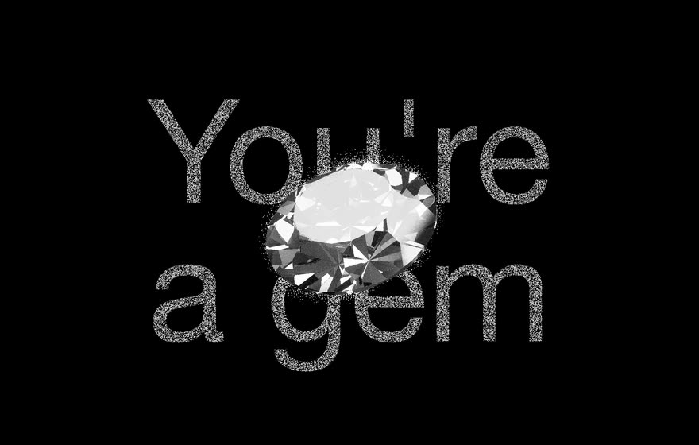</a></td>
<td><a href="https://sxwrpv-motion.vercel.app/webgl/3d/metal-knot.html">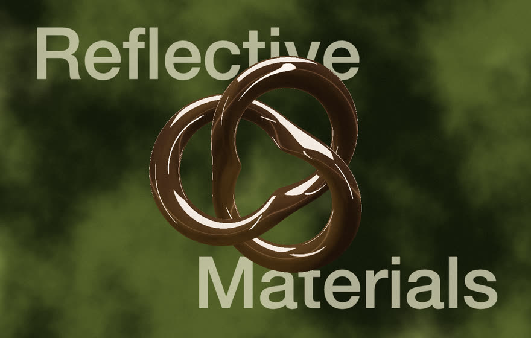</a></td>
<td><a href="https://sxwrpv-motion.vercel.app/webgl/3d/museum-statue.html">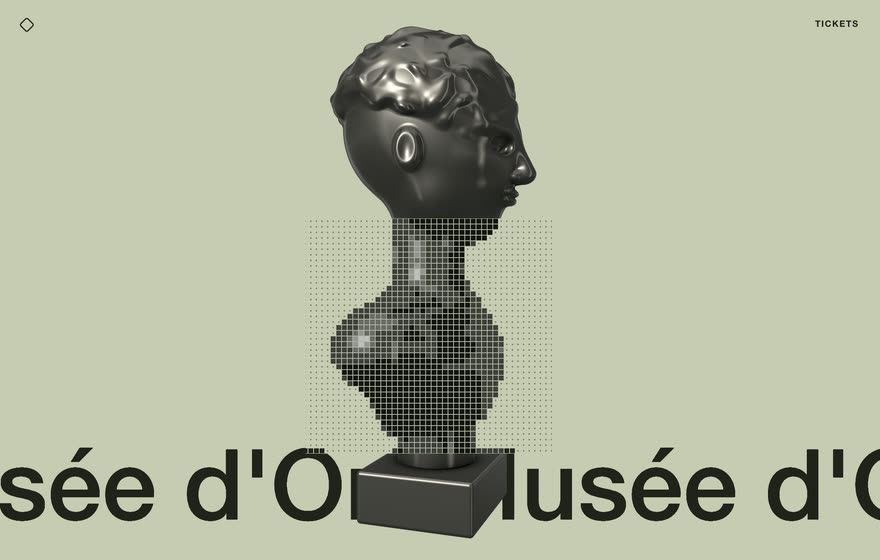</a></td>
</tr>
<tr>
<td><a href="https://sxwrpv-motion.vercel.app/webgl/text/refracted-wordmark.html">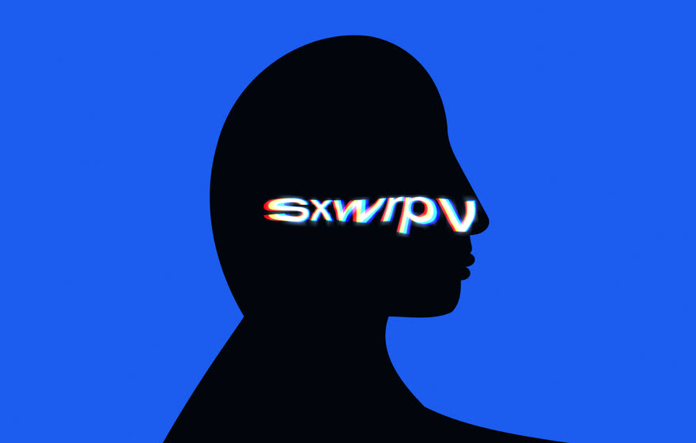</a></td>
<td><a href="https://sxwrpv-motion.vercel.app/webgl/light/neon-tubes.html">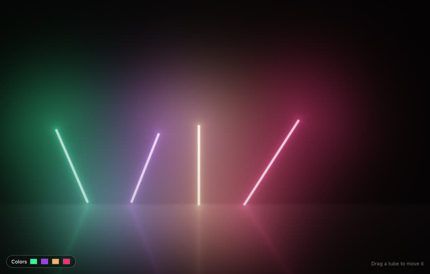</a></td>
<td><a href="https://sxwrpv-motion.vercel.app/webgl/retro/crt-tv.html">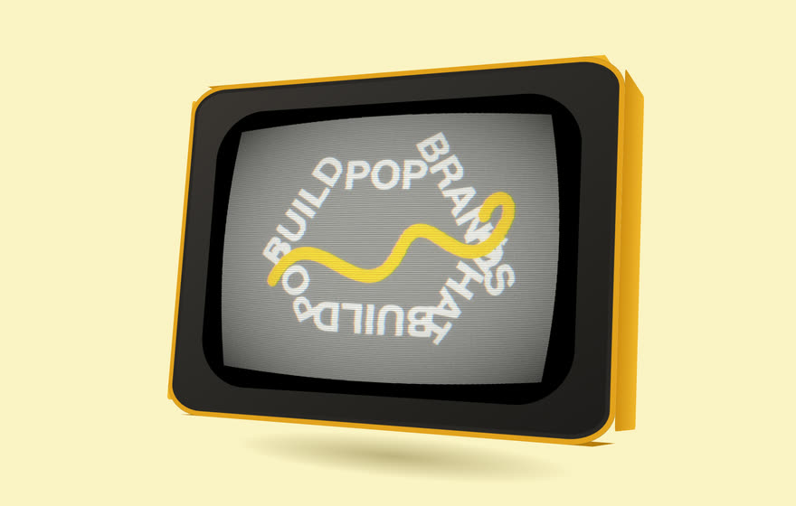</a></td>
</tr>
<tr>
<td><a href="https://sxwrpv-motion.vercel.app/webgl/dither/pop-art.html">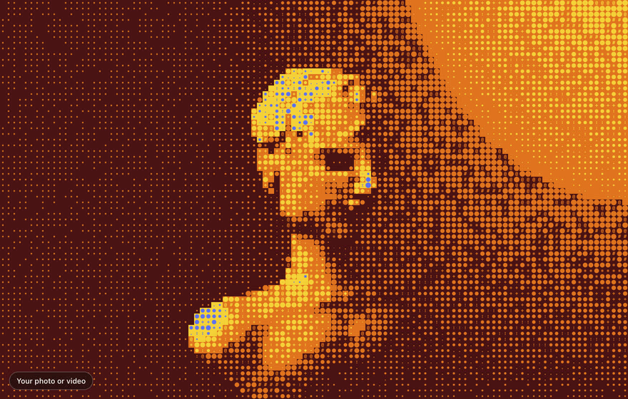</a></td>
<td><a href="https://sxwrpv-motion.vercel.app/webgl/gradients/fluted-glass.html">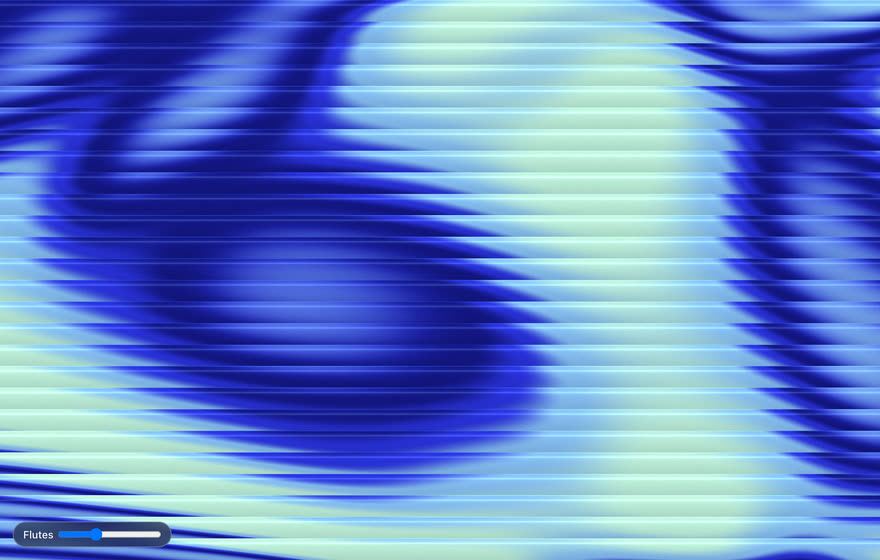</a></td>
<td><a href="https://sxwrpv-motion.vercel.app/webgl/mouse/koi-pond.html">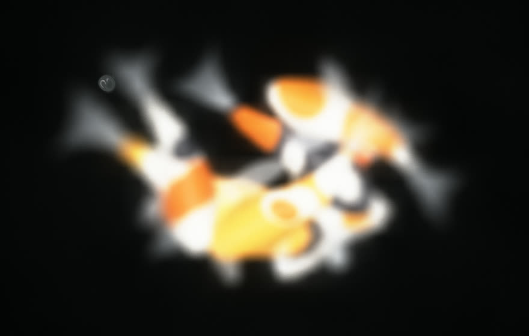</a></td>
</tr>
<tr>
<td><a href="https://sxwrpv-motion.vercel.app/webgl/text/liquid-chrome.html">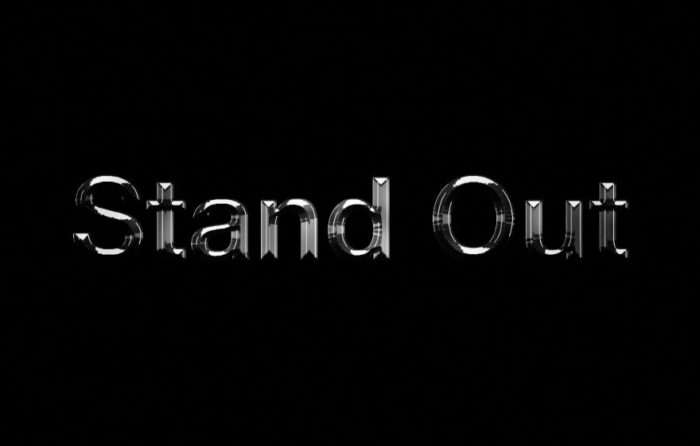</a></td>
<td><a href="https://sxwrpv-motion.vercel.app/charts.html#sankey-chart">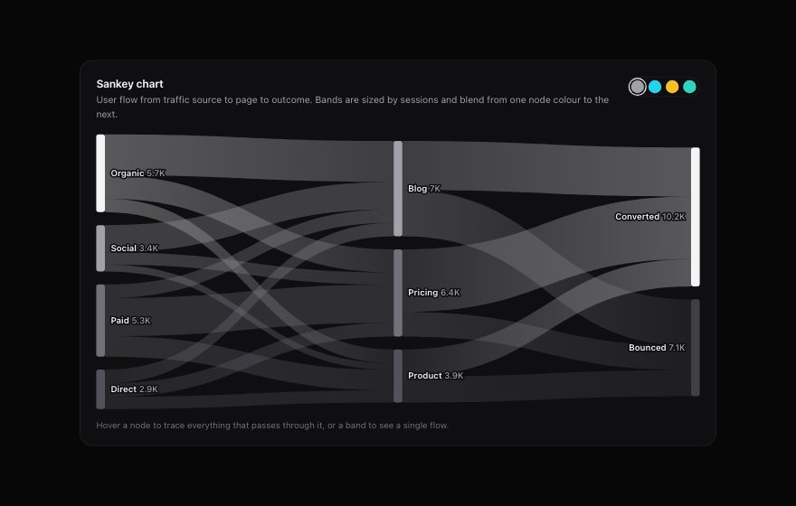</a></td>
<td><a href="https://sxwrpv-motion.vercel.app/charts.html#candlestick-chart">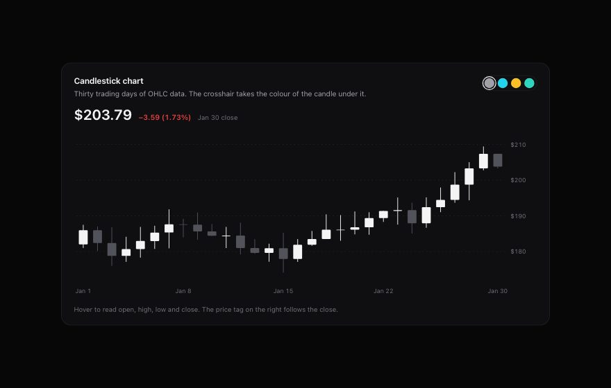</a></td>
</tr>
</table>

Every tile opens the live demo.

## What's inside

| | Count | Examples |
|---|---:|---|
| **WebGL scenes** | 122 | 3D objects, light & lasers, generative art, image effects, kinetic type, dithering, retro CRT, mouse-reactive shaders |
| **Interface animations** | 81 | scroll reveals, parallax, text effects, magnetic cursors, buttons, carousels, overlays, navigation, forms, page & view transitions |
| **Interactive charts** | 17 | line, area, bar, candlestick, sankey, sunburst, radar, heatmap, choropleth, live streaming line |

## What this shows I can do

- **Motion design in code** — easing, springs, staggers and scroll-linked timing that feel deliberate, not decorative.
- **Real-time graphics** — hand-written WebGL2 shaders: refraction, caustics, chrome, bloom, dithering, lit 3D objects.
- **Data visualisation** — animated, interactive SVG charts, including a live streaming line.
- **Front-end craft** — accessible markup, `prefers-reduced-motion`, View Transitions, responsive down to phone width.

## How it's built

- Zero dependencies: plain HTML, CSS and JavaScript, no frameworks, no build step.
- Each effect is a single self-contained `.html` file you can open on its own.
